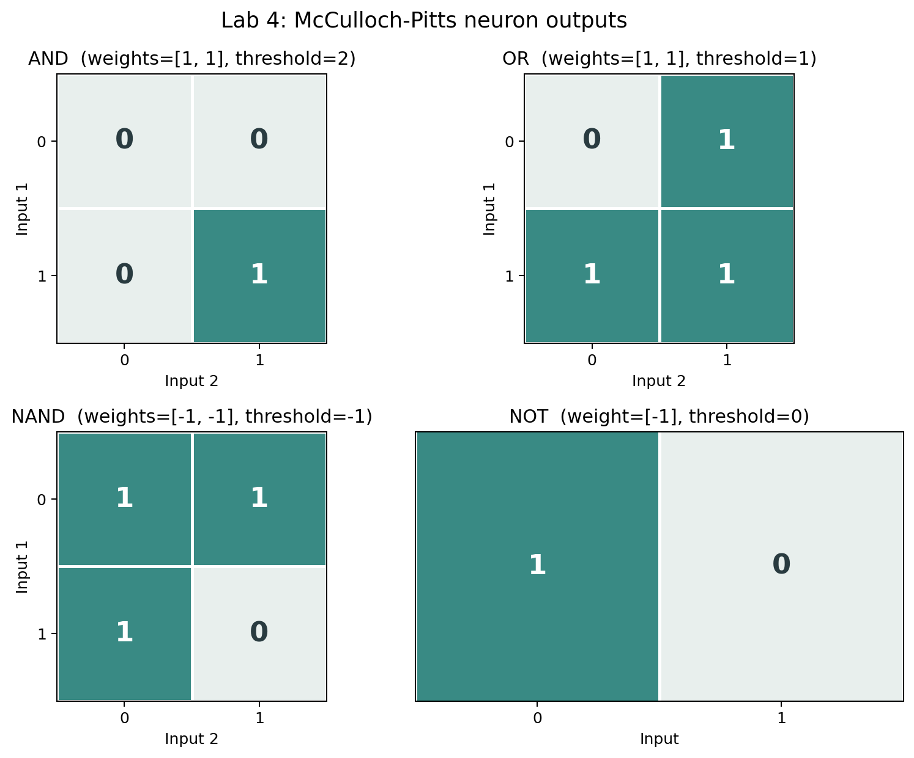

# Lab 4 - McCulloch-Pitts Neuron Implementation

## Problem Statement

The McCulloch-Pitts neuron is one of the earliest models of an artificial neuron, developed in 1943. It serves as the foundation for modern neural networks. The task for this lab is to implement this neuron model in Python and demonstrate how it can simulate basic logic gates like AND, OR, NOT, and NAND.

The neuron works by taking multiple binary inputs (0 or 1), multiplying each input by its corresponding weight, summing these weighted inputs, and then comparing the sum to a threshold value. If the weighted sum meets or exceeds the threshold, the neuron outputs 1. Otherwise, it outputs 0.

## Implementation Approach

I created a Python file named `mcculloch_pitts_neuron.py` that implements this model in a straightforward and clear manner.

### Core Neuron Function

The implementation starts with a function called `mcculloch_pitts` that accepts three parameters:
- `inputs`: a list of binary values (0 or 1)
- `weights`: a list of numerical weights corresponding to each input
- `threshold`: the activation threshold value

The function calculates the weighted sum by multiplying each input with its weight and adding them together. It then checks if this sum is greater than or equal to the threshold. If yes, it returns 1. Otherwise, it returns 0.

### Logic Gate Examples

To demonstrate the versatility of the McCulloch-Pitts neuron, I implemented four classic logic gates:

1. **AND Gate**: This gate outputs 1 only when both inputs are 1. I used weights of [1, 1] and a threshold of 2. This means the weighted sum must be 2 or higher to activate, which only happens when both inputs are 1.

2. **OR Gate**: This gate outputs 1 when at least one input is 1. I used the same weights [1, 1] but set the threshold to 1. Now even a single input of 1 produces a weighted sum of 1, which meets the threshold.

3. **NOT Gate**: This is a single-input gate that inverts the input. I used a weight of -1 and a threshold of 0. When the input is 0, the weighted sum is 0 which equals the threshold, so output is 1. When input is 1, the sum is -1 which is below the threshold, so output is 0.

4. **NAND Gate**: This is the opposite of AND - it outputs 0 only when both inputs are 1. I used negative weights [-1, -1] and a threshold of -1. When both inputs are 1, the weighted sum is -2 which is below the threshold, giving output 0. In all other cases, the output is 1.

### Truth Tables

For each logic gate, I printed a truth table that shows all possible input combinations, the calculated weighted sum, and the final output. This makes it easy to understand how the neuron processes different inputs and produces the correct results for each logic operation.

## Running the Code

To run the implementation, simply execute the Python file:

```bash
python mcculloch_pitts_neuron.py
```

## Visualization

The truth-table heatmaps show the output for all binary input combinations, using each gate's weights and threshold from the Python program.



Generate it from the repository root with `python Visualisation/visualise_lab4.py`.

The program will display the truth tables for all four logic gates along with the weights and thresholds used for each one.

## Key Takeaways

The McCulloch-Pitts neuron demonstrates that even a simple mathematical model can perform complex logical operations. By adjusting weights and thresholds, the same basic neuron structure can implement different logic gates. This concept extends to modern neural networks where learning essentially means finding the right weights and thresholds to solve specific problems.
