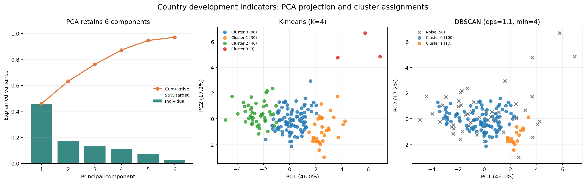
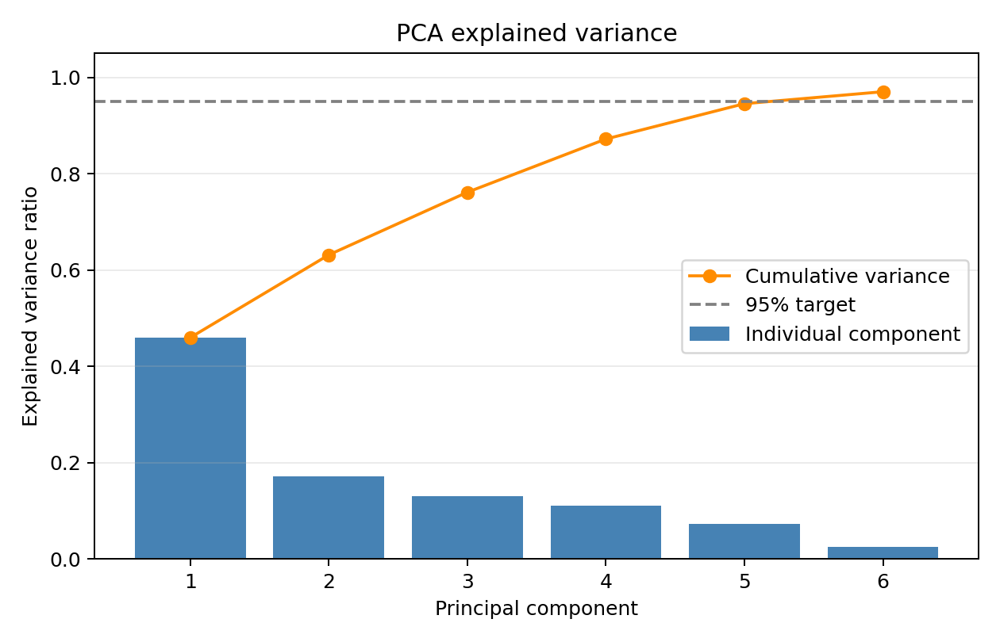
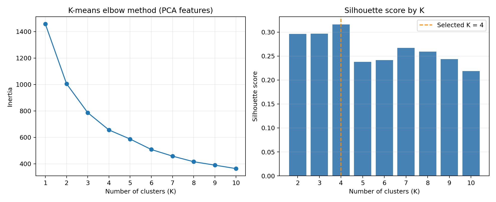
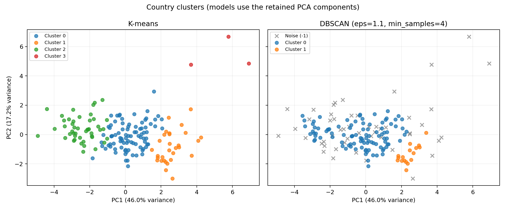

# Lab 5 - K-Means and DBSCAN Clustering

## Problem Statement

This lab reduces country development indicators with PCA, then groups countries using K-means and DBSCAN. The dataset contains one row per country and has no target column; the algorithms find groups from the numeric indicators.

## Dataset

`Country-data.csv` contains 167 countries, a country-name column, and nine numeric indicators such as child mortality, income, life expectancy, and GDP per capita. The country name is kept for the output but is not used to train either clustering model.

## Implementation Approach

### 1. Prepare and scale the features

The program reads the CSV next to `main.py`, checks that the numeric features are complete, and standardizes them with `StandardScaler`. Scaling is important because the indicators use different units and ranges.

### 2. Apply PCA

PCA reduces the nine standardized indicators to the smallest number of principal components that retain at least 95% of the variance. On this dataset, it keeps six components, representing about 97% of the variance.

### 3. K-means clustering

K-means runs on the retained PCA components. The program compares K values from 1 to 10 with an elbow plot and silhouette scores, then chooses the K with the highest silhouette score. A fixed random seed makes the result reproducible.

### 4. DBSCAN clustering

DBSCAN runs on the same PCA components with `eps=1.1` and `min_samples=4`. It assigns `-1` to countries it considers noise or outliers. These example settings can be changed at the top of `main.py`.

### 5. Visualize the clusters

The cluster plot shows the first two principal components. The models use all six retained components; the two-dimensional view is for visualization.

## Figures

The combined overview below places PCA variance and the two clustering projections together.









## Running the Program

Install the required packages and run the script from this folder:

```bash
python -m pip install pandas scikit-learn matplotlib
python main.py
```

To regenerate the combined overview from the repository root, run `python Visualisation/visualise_lab5.py`.

The script saves three plots in `figures/` and writes each country's K-means and DBSCAN labels to `country_cluster_assignments.csv`.

## Key Takeaways

- K-means assigns every country to one of the selected clusters.
- DBSCAN groups dense regions and marks some countries as noise with label `-1`.
- Scaling matters when clustering features measured on different scales.
- PCA reduces the nine standardized indicators while retaining at least 95% of their variance.
- The two-dimensional figure shows PC1 and PC2, while clustering uses all retained components.
