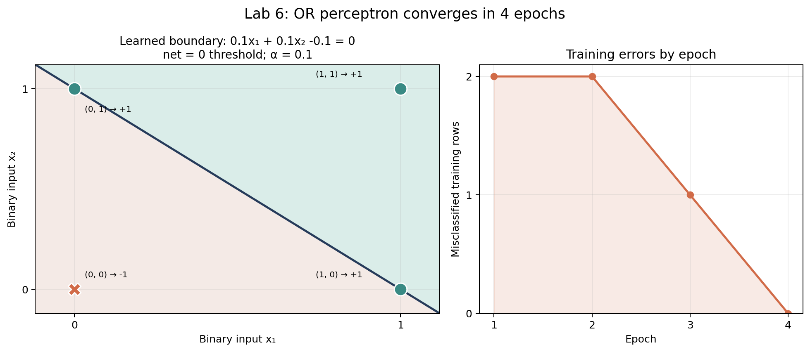

# Lab 6 - OR Function Using Perceptron Training

## Problem Statement

This lab trains a perceptron to learn the OR function. The inputs are binary values (0 or 1), while the target outputs use bipolar values (-1 or +1).

## Implementation Approach

### Perceptron Model

The program calculates the net input using the two weights and a bias:

```text
net input = (weight 1 * input 1) + (weight 2 * input 2) + bias
```

The bipolar step function predicts `+1` when the net input is at least zero, and `-1` otherwise.

### Training Data

| Input 1 | Input 2 | OR target |
| --- | --- | --- |
| 0 | 0 | -1 |
| 0 | 1 | +1 |
| 1 | 0 | +1 |
| 1 | 1 | +1 |

### Perceptron Training Algorithm

The weights and bias start at zero. When a row is misclassified, the program updates them using the bipolar perceptron rule:

```text
weight = weight + alpha * target * input
bias = bias + alpha * target
```

I selected `alpha = 0.1`. Training repeats over all four rows until a full epoch has no misclassifications, or until the safety limit of 100 epochs is reached.

## Running the Program

Run the Python program from this folder:

```bash
python perceptron_or.py
```

The output shows the weights, bias, and number of mistakes after each epoch, followed by the learned truth table.

## Visualization

The figure shows the learned `net = 0` decision boundary and misclassified rows per epoch. It uses the trained weights and bias; the activation assigns points on the boundary to `+1`.



Generate it from the repository root with `python Visualisation/visualise_lab6.py`.

## Key Takeaways

- Binary inputs and bipolar target labels use different encodings.
- The perceptron changes its weights and bias only when it misclassifies a training row.
- The OR function is linearly separable, so a single perceptron can learn it.
- The learning rate `alpha` controls the size of each update.
